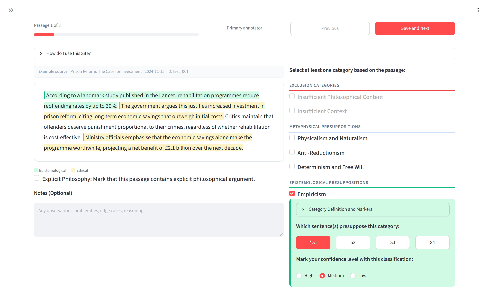
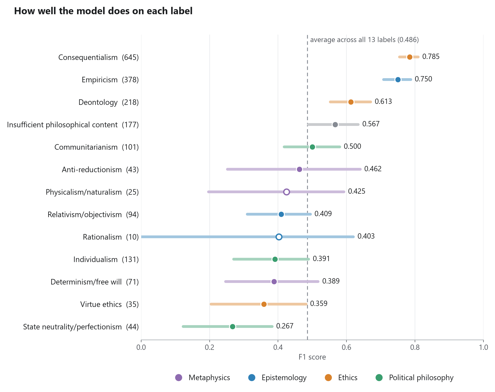

This is a classifier made to detect the philosophical assumptions that arguments in news and policy writing rely on implicitly.

This project was originally completed as my final-year dissertation (BSc Philosophy and Computer Science, Northeastern University London, March 2026, Graded 75). This repository is an improved rebuild of the submitted version. The dissertation's headline score came from a split that let paragraphs from the same article sit in both the training and test data, so I rebuilt the dataset and the evaluation. The other main addition is a deployable app, and the remaining technical changes are minor.

An editorial using the sentence "evidence-based policy should rely on what works" relies on an empiricist view of knowledge and a consequentialist view of what makes a policy right, though it says neither. This project tries to detect commitments like these automatically. Given a passage, the model assigns any of 12 philosophical positions from four domains and marks the sentences each one rests on. With enough reliable labels, this could be used to build philosophical profiles of publishers and speakers.

I chose positions that cover the breadth of philosophy, rather than ones I expected to score well, so the results show what the model can learn from the annotations. It does best on the positions that appear most often in public writing: consequentialism, empiricism and deontology. It also assigns positions more often than it should, so each one is worth checking against the sentences it marks. The main limit is the data. Three philosophy specialists who annotated a sample marked about half as many positions as I did, and more expert annotation is the next step.

I wrote about the project in a guest post for [The Computational Philosopher](https://computationalphilosopher.substack.com/p/how-much-philosophy-can-a-language), please read it as it contains further important discussion and I worked hard on it :)

## The taxonomy

| Domain | Positions |
|---|---|
| Metaphysical | physicalism and naturalism, anti-reductionism, determinism and free will |
| Epistemological | empiricism, rationalism, relativism and objectivism |
| Ethical | consequentialism, deontology, virtue ethics |
| Political-philosophical | individualism, communitarianism, state neutrality and perfectionism |

A passage can hold several positions or none. A passage with nothing philosophically
load-bearing gets a 13th label, insufficient philosophical content (IPC). The test for applying
a label comes from the annotation guidelines: *would rejecting this assumption force the author
to substantially reconstruct their argument?* Definitions and markers for each position are in
[taxonomy/categories_v1.json](taxonomy/categories_v1.json).

## Data

The corpus is 2,373 paragraphs from 1,194 articles by 34 publishers: UK and US newspapers,
magazines, think tanks and GOV.UK. I annotated them in a Streamlit tool built for the
dissertation, picking positions, a confidence for each, and the sentences that carry it:



After removing duplicate texts, 1,239 passages have gold labels, all from one annotator (me).
Three philosophy specialists each annotated 15 passages so agreement could be measured.

The article text is not in this repository, because most of it is copyrighted. The repository
has the passage ids and fold assignments, the label decisions made after annotation, the
publisher table and text-free reports on the build. [data/README.md](data/README.md) documents every
table.

Some labels come from Claude, used as a second annotator. It annotated a random sample of
passages blind, working from the guidelines alone with no labels or publication names; I went
back over 26 passages where it disagreed with me and changed the labels on 10. Later, 85
passages had to be re-marked, labels and evidence, because their evidence had been clicked
against a different sentence split from the stored one. I re-marked 36 myself and adopted
Claude's blind annotations for the other 49. Those are recorded as `label_source = remarked_claude` in the gold labels.

## What changed from the dissertation

The dissertation reported a macro-F1 of 0.652 on a single test split of 135 passages, made
passage by passage, so one article's paragraphs could land on both sides. In this version:

- Passages are grouped by article and by duplicated text before splitting. The build fails if
  any article, URL or duplicate ends up in two folds.
- Models are scored by 9-fold cross-validation over three seeds, with 95% intervals from
  resampling whole articles.
- A tenth fold (125 labelled passages) is held back as a lockbox. It can only be loaded through
  a function that logs each opening ([reports/lockbox_log.md](reports/lockbox_log.md)), and no
  model trains on it.
- Every model is compared with a label-frequency prior and a TF-IDF + logistic regression
  baseline.

Run under this protocol, the dissertation's exact recipe scores 0.538 with passage-level folds
and 0.489 with article-grouped folds. The leakage on its own is worth 0.049 macro-F1 (95%
interval 0.014 to 0.070).

I also changed the training recipe: hard targets instead of confidence-weighted ones, model
selection on average precision, per-label thresholds only where a label has at least 10
validation positives, and IPC never predicted alongside a category. That made no detectable
difference to macro-F1, but the probabilities are much better calibrated (calibration error
0.022 against 0.060). Adding back the dissertation's class weights didn't help.

## Results

Macro-F1 over all 13 labels. Development numbers are from cross-validation (mean of three seeds,
95% interval); the lockbox column is the held-out fold.

| Model | Development | Lockbox |
|---|---|---|
| Label-frequency prior | 0.158 [0.151, 0.165] | |
| TF-IDF + logistic regression | 0.318 [0.286, 0.351] | 0.249 [0.195, 0.320] |
| Dissertation recipe, passage-level folds | 0.538 [0.473, 0.562] | |
| Dissertation recipe, article-grouped folds | 0.489 [0.441, 0.518] | 0.452 [0.361, 0.563] |
| Rebuilt recipe (`fixed_unweighted`) | 0.486 [0.437, 0.512] | 0.466 [0.365, 0.580] |



The model does well on the common positions and poorly on the rare ones. Rationalism and
physicalism appear in fewer than 20 articles, so their scores mean very little. Full tables,
including precision, recall and calibration per label, are in
[reports/results/](reports/results/).

### Pointing at the evidence

The annotations record which sentences carry each position, and the passage models above ignore
that. The sentence model ([src/presupp/sentence_model.py](src/presupp/sentence_model.py))
encodes a passage once, averages the token states within each sentence, and scores every
sentence for every position, trained on the annotated evidence. In the `v3_mil` variant a
passage's score for a position is its best sentence's score, so every flag comes with the
sentence that triggered it.

The baseline below is the rebuilt recipe retrained on the same (re-marked) data, finding
evidence by scoring each sentence on its own. "First sentence is evidence" means how often the
first sentence the model marks for a gold position is one the annotator marked. A sentence
picked at random scores 0.41 (0.43 on the lockbox).

| | Macro-F1, dev | Macro-F1, lockbox | First sentence is evidence, dev | Same, lockbox |
|---|---|---|---|---|
| Rebuilt recipe | 0.483 | 0.439 | 0.606 | 0.615 |
| `v3_mil` | 0.473 | 0.437 | 0.632 | 0.630 |

Before scoring it, I set a rule that the sentence model would only replace the old one in the
demo if its macro-F1 was no more than 0.010 below the baseline's. It came in 0.0106 below. I
used it anyway, because the paired interval on that difference (−0.032 to +0.010) can't
separate the two, while the evidence gain (+0.026, interval +0.007 to +0.044) is clear.
[reports/results/v3/selection_v3.md](reports/results/v3/selection_v3.md) has the numbers.

The lockbox has been opened three times: for the rebuilt recipe, for the sentence model, and to
re-score the sentence model after fixing a bug in its threshold tuning (nothing was retrained).

## Demo

[apps/demo](apps/demo/README.md) is a Gradio app. Paste an article, a speech or a policy paper
and it splits the text into passages like the training ones (skipping menus, captions,
reference lists and non-English text), then reads it back with the positions it found in the
margin and their evidence sentences underlined. A panel under each passage shows every
position's score against its threshold and its F1 in testing.

The weights aren't in the repository, because they were trained on copyrighted text.

## Repository layout

```
configs/              one YAML file per experiment; the description says what it tests
taxonomy/             category definitions
data/
  adjudication/       label decisions made after annotation (ids and labels only)
  reference/          publisher table: country and type of publication
  splits/             fold assignment per passage
src/presupp/
  data/               build the dataset from the raw exports: parsing, dedup, folds, lockbox
  experiment.py       config loading
  protocol.py         which folds train, validate and test in each round
  transformer.py      fine-tuning the passage classifier
  sentence_model.py   the sentence model
  baselines.py        prior and TF-IDF baselines
  decisions.py        thresholds and the IPC rule
  train.py            run an experiment's cross-validation
  evaluate.py         score finished runs, write reports/results/
  compare.py          paired comparisons between experiments
  evaluate_evidence.py  how well sentence scores find the annotated evidence
  domains.py          scores rolled up to the four domains
  choose.py           picks the sentence-model variant
  final.py            lockbox evaluation
  release.py          train and save the demo model
  inference.py        classify new text with a saved model
  reading.py          turn pasted text into passages
apps/demo/            the Gradio app, plus Modal and Hugging Face hosting
scripts/cluster/      SLURM job scripts for the GPU runs
reports/              data build report, results, figures, lockbox log
tests/
```

## Running it

The pinned CPU environment I used (Python 3.12):

```bash
python -m venv .venv
source .venv/bin/activate        # .venv\Scripts\activate on Windows
pip install -r requirements-lock-cpu.txt --extra-index-url https://download.pytorch.org/whl/cpu
pip install --no-deps -e .
python -m pytest
```

Or `pip install -e ".[train,dev]"` for unpinned versions. The tests build small synthetic
datasets and a two-layer transformer, so they need neither the corpus nor a GPU; checks on the
real build are skipped when it isn't there.

Everything else needs the raw annotation exports from the original project, which include
article text. They go in `data/raw/v1/` under the names listed in
[reports/data_build_v1.md](reports/data_build_v1.md). Then:

```bash
python -m presupp.data.build                    # deterministic; checks for leakage
python -m presupp.train configs/tfidf_lr.yaml   # every round and seed
python -m presupp.evaluate configs/tfidf_lr.yaml
```

The transformer experiments ran on V100 GPUs on Northeastern's Explorer cluster, with the job
scripts in `scripts/cluster/`. Each script's header shows its usage; `env.sh` and
`setup_env.sh` load Explorer's modules and need changing for another cluster.

```bash
bash scripts/cluster/setup_env.sh                          # once, on a login node
bash scripts/cluster/submit_all.sh                         # cross-validation, one job each
sbatch scripts/cluster/final.sbatch "reason" configs/fixed_unweighted.yaml    # lockbox
sbatch scripts/cluster/release.sbatch configs/v3_mil.yaml                     # demo model
```
